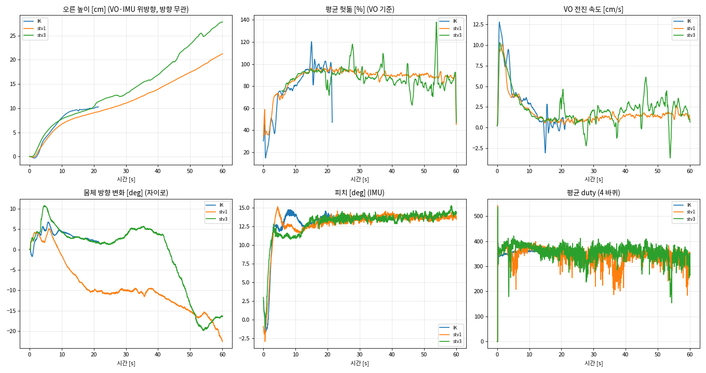
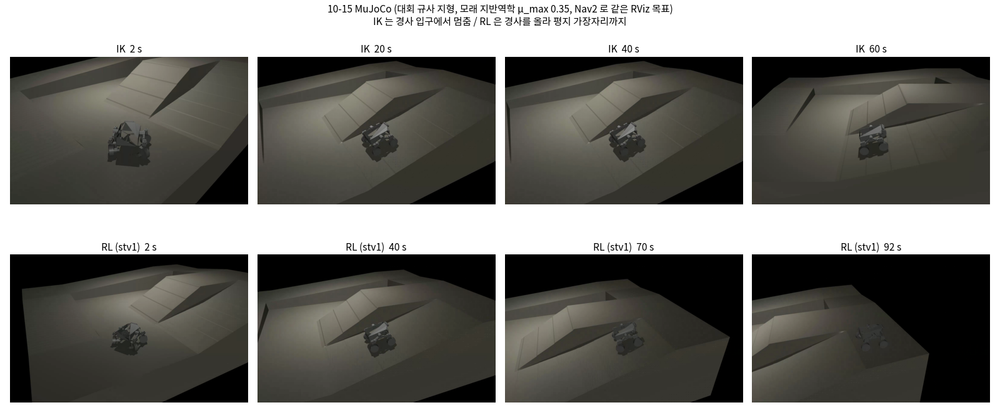
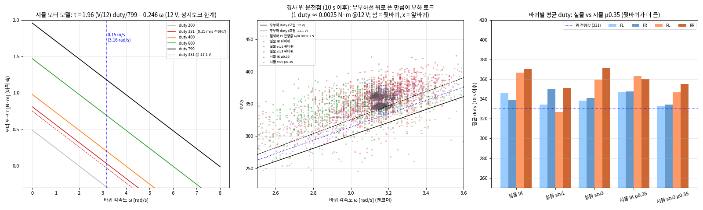

# 10-18 모래 경사 직진 비교 — IK / stv1 / stv3

## 요약

- 같은 모래 경사(약 13.5°)에서 0.15 m/s 직진 명령을 60 s 주고 비교함.
- **오른 높이: stv3 27.8 cm > stv1 21.2 cm ≫ IK 10.3 cm.**
  - IK 는 20 s 쯤 제자리 헛돎으로 파묻혀 중단함.
- 오르는 동안 바퀴 헛돎은 89–94 % 로, 거의 미끄러지는 상태였음.
- **마찰계수**: 지면이 내 준 견인 ≈ 수직력 × (경사 성분 0.24 + 침하 저항 약 0.12) = **약 0.35 배**임.
- MuJoCo 모래 모델(`terramech.py`, 10-18 저녁 수정 전)에서 **μ_max = 0.35** 로 두면 헛돎·오른 높이·duty 가 실물과 같이 나옴.
- 같은 모래 설정(μ_max 0.35)의 10-15 MuJoCo 시험(대회 지형, Nav2)에서도 **IK 는 경사 입구에서 멈추고 RL 은 올라감** — 실물과 같은 경향임.
- stl15 도 같은 날 시험했으나, ORB 추적이 끊겨 처음 46 s 의 VO 기록이 없어 그래프·분석에서 제외함 (원자료는 `raw/robot/stl15_145526.npz` 로 같이 올림).

| 그림 | 내용 |
|---|---|
| `fig/straight_1018.png` | 실물 3 주행: 높이, 헛돎, 전진 속도, 방향, 피치, duty |
| `fig/traction_real.png` | 실물: 바퀴 토크(duty 모델), 쓴 마찰계수, 헛돎, 바퀴별 토크 |
| `fig/sim_vs_real.png` | 실물 vs MuJoCo (μ 0.30 / 0.35 / 0.40) + 시뮬 내부 (순간 마찰계수, 침하, 저항) |
| `fig/sim_1015_ik_vs_rl.png` | 10-15 MuJoCo 화면 녹화: IK (멈춤) vs RL stv1 (올라감) |
| `fig/motor_model.png` | 시뮬 모터 모델 (토크–속도 직선) + 실물·시뮬 운전점 (duty vs 바퀴 속도) + 바퀴별 duty |

- 재현 (이 폴더에서): `python3 scripts/analyze_robot.py` → `python3 scripts/plot_sim_vs_real.py` → `python3 scripts/plot_motor.py`
- 파일 구성과 데이터 키 설명은 7 절에 있음.



---

## 1. 시험 조건

- **일시**: 2026-10-18 14:53–14:59. 순서는 IK → IK → (stl15) → stv1 → stv3.
- **경사**: 모래, IMU 피치 13.3–14.0° (경사 위 평균).
- **명령**: `run_policy.py --cmd 0.15 0 0 --seconds 60 --vo-port 5600 --rt 50 --cpu 3 --gc-off`
- **VO**: ORB-SLAM3 스테레오 → `vo_relay.py` → UDP 5600 (ORB 기록 `raw/orb_vo1018_19/`).
- **출발**: 경사 아래쪽 같은 부근. 출발점 표시나 모래 고르기는 하지 않음.
- **로버**: 질량 2.397 kg (CAD 값, 실측 무게로 바꿔야 함), 바퀴 반경 47.5 mm, 배터리 11.1–11.2 V (서보 보고값).

| 파일 (`raw/robot/`) | 정책 | export | 조향 잔차 폭 |
|---|---|---|---|
| `ik_145309.npz` | IK (잔차 끔) — 경사 진입 전 15 s 에 멈춰 비교에서 제외 | – | – |
| `ik_145429.npz` | IK (잔차 끔) | – | – |
| `stl15_145526.npz` | stl15 — 처음 46 s VO 없음, 그래프·분석 제외 (원자료만) | `res8_mlp_v1_lc3000_st15` | 15° |
| `stv1_145659.npz` | stv1 | `res8_mlp_v1_rc4000` | 30° |
| `stv3_145842.npz` | stv3 (VO 관측) | `res8_mlp_v3vo_rc4000` | 30° |

## 2. 결과

| 정책 | 주행 | VO 유효 | **오른 높이** | 경사 위 헛돎 | 경사 위 전진 (VO) | 방향 변화 | 평균 duty (FL FR RL RR) |
|---|---|---|---|---|---|---|---|
| IK | 21 s (중단) | 100 % | **10.3 cm** | 94 % | 0.8 cm/s | +2° | 346 339 367 370 |
| stv1 | 60 s | 100 % | **21.2 cm** | 91 % | 1.3 cm/s | −23° | 334 350 327 351 |
| stv3 | 60 s | 92 % | **27.8 cm** | 89 % | 1.7 cm/s | −16° | 339 341 360 371 |

### 시간에 따른 높이 (cm 누적, 괄호 = 그 10 s 동안)

| 정책 | 10 s | 20 s | 30 s | 40 s | 50 s | 60 s |
|---|---|---|---|---|---|---|
| IK | 8.0 | 10.0 (+2.0) | 중단 | | | |
| stv1 | 6.7 | 9.0 (+2.4) | 11.0 (+2.0) | 13.9 (+2.9) | 17.4 (+3.5) | 21.2 (+3.8) |
| stv3 | 7.7 | 10.3 (+2.6) | 13.0 (+2.6) | 16.9 (+3.9) | 23.2 (+6.3) | 27.8 (+4.6) |

### 정책 출력 (10 s 이후 평균, FL FR RL RR)

| 정책 | 조향 잔차 [°] | 바퀴 속도 잔차 (−1…+1, ×0.6 = 배율 변화) |
|---|---|---|
| stv1 | −1.4, −0.1, **+18.5**, −2.4 | −0.05, +0.05, **−0.21, −0.10** |
| stv3 | +0.8, −0.7, **+11.2, −6.0** | −0.03, −0.01, −0.04, +0.01 |

- stv1: 뒷왼쪽 바퀴를 크게 꺾고, 뒷바퀴를 늦춤.
- stv3: 뒷바퀴 두 개를 벌림(뒷왼쪽 +11°, 뒷오른쪽 −6°). 바퀴 속도는 거의 그대로 둠.

### 해석

- **처음 15 s 는 세 정책이 같음.**
  - 경사 입구에서 10 s 에 약 8 cm 오름.
  - 그 뒤 헛돎 90 % 이상으로 기어감.
- **15–20 s 에 IK 만 느려짐.**
  - 15–20 s 전진 속도: IK 0.36 cm/s, stv1 0.84, stv3 1.23.
  - 육안으로는 "모터 잠김" 이었으나, 텔레메트리로는 바퀴가 끝까지 0.15 m/s 로 돌았음.
  - duty 340–370 정상, 보호 동작 없음. 즉 헛돌며 제자리를 판 것임.
  - IK 는 10–20 s 에 토크를 stv3 보다 44 %, stv1 보다 23 % 더 씀 (같은 식의 상대값, 4 절). 더 쓴 힘은 오르는 데가 아니라 파는 데 들어감.
- **RL 은 파묻히지 않고 60 s 내내 올랐고, 갈수록 빨라짐.**
  - 40–60 s 에 stv1 은 10 s 당 3.5–3.8 cm, stv3 는 4.6–6.3 cm.
  - 두 정책 모두 뒷바퀴를 벌리는 행동이 공통임.
- **stv3 가 가장 높이 오름 (stv1 보다 +6.6 cm).**
  - 차이는 40 s 이후에 벌어짐.
  - 이때 −16° 쯤 비스듬히 틀어지며 헛돎이 80–85 % 로 내려감.

## 3. 마찰계수

### 3-0. 두 숫자의 뜻 (0.24 와 0.35 는 범위가 아님)

- **μ_max 0.35** = 바퀴가 헛돌 때 모래가 바퀴를 앞으로 미는 힘의 최대치 ÷ 수직력. 모래 자체의 미는 힘임.
- **순 견인 0.24** = 위 힘에서 침하·구름 저항(파묻힌 바퀴가 앞 모래를 밀어내는 힘)을 뺀 나머지 ÷ 수직력. 로버를 경사 위로 밀어 올리는 데 실제로 쓰이는 몫임.
- 관계: **순 견인 0.24 = 미는 힘 0.35 − 저항 0.12**.
- 0.24 는 실물에서 바로 나온 값임 (일정 속도로 기어갔으니 순 견인 = tan 13.5°).
- 0.35 는 실물에서 직접 잰 값이 아님. 시뮬에서 μ_max 를 바꿔 가며 실물과 맞춘 값이고, 저항 0.12 도 시뮬 모델 기준의 추정임.
- 시뮬에서 고정인 것은 최대치(μ_max)뿐임.
  - 매 순간의 마찰계수 μ(i) 는 헛돎에 따라 매 스텝 바뀜 (평지 출발 0.28 → 경사 헛돎 89 % 에서 0.349).
  - 저항도 침하 깊이에 따라 바뀜 (출발 0.05 → 침하 10 mm 에서 0.12).
- 실물로 알 수 있는 것은 "헛돎 89–94 % 에서 순 견인 0.24" 한 지점뿐임. 헛돎이 작을 때나 위치별 차이는 이번 데이터로 모름.

### 3-1. 물리로 정하는 값 (가장 확실)

- 로버는 경사에서 거의 일정 속도(1–2 cm/s)로 기어갔으므로, 견인력 = 경사 아래로 끄는 중력 + 모래 저항임.
- 따라서 헛돎 89–94 % 일 때 지면이 낸 견인 / 수직력은 **최소 tan 13.5° = 0.24** 임.
- 여기에 침하 저항이 더해짐. 실물로 직접 재지는 못했고, 시뮬 맞춤에서 수직력의 약 0.12 배였음.

| 구성 | 값 (÷ 수직력) | 근거 |
|---|---|---|
| 경사 버티기 | 0.24 | tan 13.5°, 실물 IMU 피치 |
| 침하·불도징 저항 | ~0.12 | 시뮬 μ 0.35 맞춤에서 ΣR/mg 0.12–0.13 (실물 직접 측정 없음) |
| **헛돌 때 모래가 내는 최대 전단 (μ_max)** | **~0.35** | 위 둘의 합 = 시뮬 맞춤값 |


### 3-2. 시뮬 맞춤 (μ_max 를 바꾸며 실물과 비교)

- **조건**: 이상적 13.5° 램프, 0.15 m/s 고정 명령, 60 s, 경사 0.3 m 앞 출발, 바퀴 관절 마찰 0 (`scripts/slope_drive_log.py`).

| | 60 s 높이 | 헛돎 | 평균 duty | 순간 μ(i) | 침하 | ΣR/mg |
|---|---|---|---|---|---|---|
| **실물 stv1 / stv3** | 21.2 / 27.8 cm | 91 / 89 % | ~340 / ~350 | – | – | – |
| **실물 IK (20 s 까지)** | 20 s 에 10.0 cm | 94 % | ~355 | – | – | – |
| 시뮬 μ 0.30 IK / stv3 | 8.7 / 8.2 cm | 97 / 96 % | ~350 / ~315 | 0.299 | 10 mm | 0.13 |
| **시뮬 μ 0.35 IK / stv3** | **25.5 / 24.7 cm** (IK 20 s 9.7) | **89 / 88 %** | **~354 / ~347** | 0.349 | 10 mm | 0.12 |
| 시뮬 μ 0.40 IK / stv3 | 72 cm (꼭대기, 약 34 / 44 s) | 30 / 40 % | ~330 / ~355 | 0.36 | 9 mm | 0.11 |

- **μ 0.35 가 실물과 맞음.**
  - 높이·헛돎·duty 가 모두 들어옴.
  - 10 s 마다 높이(시뮬 IK 5.8 / 9.7 / 13.7 / 17.7 / 21.5 / 25.5 cm)가 실물 stv1 과 stv3 곡선 사이에 들어감 (`fig/sim_vs_real.png` 왼쪽 위).
- **경계가 날카로움.**
  - μ 0.30 이면 8 cm 에서 거의 멈춤.
  - 0.40 이면 40 s 안에 꼭대기에 감.
  - 실물 모래는 그 경계 위(0.35 근처)에 있었음.

### 3-3. 같은 모래 설정에서 IK vs RL (10-15 MuJoCo 시험)



- **조건**
  - `ros/nav2_isaac.launch.py soil:=sand mu:=const:0.35`: 대회 규사 지형 높이맵, 모래 지반역학 μ_max 0.35, 바퀴 관절 마찰 53 duty, 관측·행동 지연 1 스텝.
  - RViz 로 같은 목표(경사 위 평지)를 찍고 Nav2 로 이동함.
  - IK 한 번, RL(stv1, 처음부터 켬) 한 번 실행함.
- **IK**: 경사 입구에 붙은 뒤 60 s 동안 제자리에서 헛돎.
- **RL (stv1)**: 처음 약 45 s 는 입구에서 버티다가, 이후 경사를 타고 올라 평지 가장자리까지 감 (92 s).
- 실물 10-18 과 같은 경향임: IK 는 파묻혀 멈추고, RL 은 파묻히지 않고 계속 오름.
- 원본 화면 녹화 2 개(10-15 17:18 IK, 17:30 RL)에서 프레임을 뽑음.

## 4. 모터 토크

### 4-0. 시뮬 구동 모델 (실물 펌웨어와 같은 구조)



- 바퀴 하나의 구동은 세 단계임: **펌웨어 PI 가 duty 결정 → DC 모터 직선 모델이 토크 계산 → 정지 토크 한계로 자름**.
- 코드: ksrc 저장소 `sim/isaac/ksrc_rover/source/ksrc_rover/utils/actuators_torch.py` (`WheelPI`, `drive_torque`), `sim/rl/sim2sim_isaac.py` (`MjRover.step`).
  - `WheelPI` 는 펌웨어 `firmware/common/wheel_pi.c` 를 그대로 옮긴 것임 (코드 주석상 C 와 값을 비교하는 테스트가 있음).

```python
# 1) 펌웨어 PI (20 ms 마다, 바퀴별)                     ω_ref: 목표 바퀴 각속도 (IK 결과 x RL 속도 배율)
r_m   = r_m + (ω_ref - r_m) * dt / (0.040 + dt)          # 목표를 40 ms 1차 필터
e     = r_m - ω_meas                                     # ω_meas: 엔코더 속도 (지난 20 ms)
ff    = ω_ref / 0.0097 + 5 * sign(ω_ref)                 # 전향 (무부하 duty): 0.15 m/s = 3.16 rad/s -> 331 duty
ff   += 40 * sign(ω_ref)   if |ω_meas| < 0.01            # 정지에서 출발할 때 킥 (정지 마찰)
i     = clip(i + 2062 * e * dt, ±200)                    # 적분 (포화 시 멈춤)
duty  = clip(ff + clip(82.5 * e + i, ±250), ±799)        # 보정은 ±250 duty 까지
#   + 보호: 0.5 s 넘게 보정 최대인데 안 돌면 '고착' -> 전향만,  엔코더 방향이 반대면 전향만

# 2) DC 모터 직선 모델 (5 ms 물리 스텝마다)
τ = 1.96 * (V/12) * duty/799 - (1.96/7.96) * ω           # 정지 토크 1.96 N·m, 무부하 7.96 rad/s (12 V), V = 12 (시뮬)

# 3) 정지 토크 한계
τ = clip(τ, -1.96 * (1 + ω/7.96), 1.96 * (1 - ω/7.96))
#   + (선택) 바퀴 관절 쿨롱 마찰: frictionloss = 1.96 * F/799  (F = --wheel-friction-duty; 3-2 는 0, 3-3 은 53)
```

| 기호 | 값 | 출처 |
|---|---|---|
| 정지 토크 τ_stall | 1.96 N·m (12 V, 바퀴 축) | 설정값 (`contract.py` `DRIVE_EFFORT_NM`, 실측 근거 기록 없음) |
| 무부하 속도 ω_max | 7.96 rad/s (12 V) | 10-13 실측 7.68 @ 11.65 V, 7.53 @ 11.25 V 에서 12 V 로 환산 |
| 전향 기울기 k_duty | 0.0097 rad/s / duty | 10-13 바퀴 띄움 실측 (200 duty → 1.94, 400 → 3.88 rad/s, 4 바퀴 평균), 펌웨어 기본값 |
| 정지 마찰 | 출발 35–52 duty, 멈춤 31–37 duty | 10-13 실측 (킥 40 duty 로 처리) |

- **그림 읽는 법**
  - 왼쪽: duty 별 토크–속도 직선. 0.15 m/s(3.16 rad/s)에서 전향값 331 duty 의 토크는 0.03 N·m 로 거의 0 임 (무부하로 그냥 도는 duty).
  - 가운데: 경사 위 실제 운전점. 무부하선(검은 실선, 12 V)보다 위로 뜬 만큼이 부하 토크임 (1 duty ≈ 0.0025 N·m).
    - 실물 점과 시뮬 μ0.35 점이 같은 자리(3.1–3.2 rad/s, duty 340–370)에 모임.
    - 단, duty 의 대부분(~331)은 PI 가 0.15 m/s 를 맞추는 무부하 값이고, 부하 몫은 바퀴당 10–40 duty 뿐임. duty 가 같다는 것은 약한 근거임.
  - 오른쪽: 바퀴별 평균 duty. 실물과 시뮬 모두 뒷바퀴(RL, RR)가 앞바퀴보다 큼 (경사에서 무게가 뒤로 실림).

| 평균 duty (10 s 이후) | FL | FR | RL | RR |
|---|---|---|---|---|
| 실물 IK | 346 | 339 | 367 | 370 |
| 실물 stv1 | 334 | 350 | 327 | 351 |
| 실물 stv3 | 339 | 341 | 360 | 371 |
| 시뮬 IK μ0.35 | 347 | 348 | 363 | 360 |
| 시뮬 stv3 μ0.35 | 333 | 334 | 347 | 355 |

### 4-1. 실물 토크 계산 방법

- 실물 로그의 duty 와 엔코더 바퀴 속도 ω 를 위 2) 모델에 넣어 토크를 계산함.

```
τ = τ_stall · (V/12) · duty/799 − D · ω        τ_stall = 1.96 N·m (12 V),  D = τ_stall / 7.96 rad/s = 0.246 N·m·s
견인력 F = Σ τ / r,   쓴 마찰계수 μ_mob = F / (m g cosθ)
```

### 4-2. 결과 (`fig/traction_real.png`)

| 정책 | 바퀴별 토크 [N·m] V = 11.1 | 바퀴별 토크 [N·m] V = 12 | μ_mob (11.1 V / 12 V) |
|---|---|---|---|
| IK | 0.009, −0.008, 0.054, 0.063 | 0.072, 0.054, 0.122, 0.131 | 0.11 / **0.35** |
| stv1 | 0.002, −0.008, 0.063, 0.065 | 0.063, 0.057, 0.123, 0.130 | 0.11 / **0.34** |
| stv3 | 0.003, −0.002, 0.058, 0.060 | 0.066, 0.061, 0.124, 0.128 | 0.11 / **0.35** |
| 시뮬 μ 0.35 (12 V 모델) | | | **0.34** |

- 표 값은 `python3 scripts/analyze_robot.py --volt 11.1` / `--volt 12` 로 다시 볼 수 있음. 기본값(주행마다 서보가 보고한 전압 11.05–11.22 V)으로는 μ_mob 0.10–0.14.
- **뒷바퀴가 앞바퀴의 약 2 배 토크를 냄.**
  - 경사에서 무게가 뒤로 옮겨 가기 때문임. 시뮬 수직력도 앞 4.5 N, 뒤 6.8 N.
  - 뒷바퀴가 견인을 대부분 맡으며, RL 이 뒷바퀴를 건드리는 행동과 연결됨.
- **절대값은 아직 믿을 수 없음.**
  - duty ~350 중 대부분이 바퀴를 0.15 m/s 로 그냥 돌리는 무부하 몫임 (모델 무부하 duty: 12 V 에서 317, 11.1 V 에서 343; 펌웨어 전향값 331). 실제 하중은 남는 차이(바퀴당 10–40 duty)뿐임.
  - 그래서 전압 8 % (11.1 → 12 V) 차이로 토크가 3 배 바뀜.
  - 측정 전압 11.1 V 로는 μ_mob 0.11 로, 경사를 버티는 최소값 0.24 보다 작아 물리적으로 불가능함.
  - 12 V 로 두면 0.35 로 시뮬과 같음.
  - 즉 실물 모터는 이 모델보다 같은 duty 에서 힘이 더 남 (전압 측정 위치, 모터 드라이버 저부하 특성, 데드밴드 등).
- **정책끼리 상대 비교는 같은 오차를 공유하므로 쓸 수 있음.** 10–20 s 토크 합은 IK 가 stv3 보다 44 %, stv1 보다 23 % 큼.

### 4-3. 시뮬 모터 모델에 넣을 것

- **이 시험에서 맞은 것은 duty 운전점까지임. 모터 토크 모델 자체는 검증되지 않음.**
  - 시뮬(12 V 가정) μ 0.35 에서 duty 347–363, 실물 334–371 로 같은 범위임.
  - 그러나 실물 전압 11.1 V 를 모델에 넣으면 실물 duty 로는 경사를 버틸 힘이 안 나옴 (μ_mob 0.11 < 0.24). 실제 전압에서는 모델이 실물을 설명하지 못함.
  - 즉 실물 모터가 모델보다 같은 duty 에서 힘이 더 나거나, 서보가 보고한 전압이 모터에 걸리는 전압과 다름.
  - μ 0.35 는 높이·헛돎에 맞춰 고른 값이라, duty 일치는 추가 확인일 뿐 모터 모델의 독립 검증이 아님.
- **전압 의존(`volt_scale`)은 실측으로 다시 맞춰야 함.**
  - 지금 식으로는 11.1 V 에서 시뮬 로버가 실물보다 훨씬 약해짐.
  - 배터리 전압 DR 을 쓴다면 0.95–1.0 정도로 좁혀 둘 것.
- **토크 절대값 보정 실험이 필요함.**
  - **견인 실험**: 미끄럽지 않은 바닥(고무 매트)에서 용수철저울로 0 / 2 / 4 / 6 N 당기며 0.15 m/s 로 달림. duty 증가분 ↔ 알려진 힘으로 τ/duty 기울기와 원점 오프셋을 맞춤.
  - **경사 실험**: 미끄럽지 않은 0 / 5 / 10 / 15° 경사를 0.15 m/s 로 오르면, 힘이 m g sinθ 로 알려져 있으니 같은 맞춤이 됨.
  - 보정되면 모래 위 duty 로 바로 지금 마찰계수를 잴 수 있음.

## 5. MuJoCo 모래 구현 (10-18 저녁 수정 전)

- 코드는 ksrc 저장소 `sim/rl/terramech.py` (사본 `scripts/terramech_legacy_reference.py`) 와 `sim/rl/sim2sim_isaac.py` 에 있음.

### 5-1. 왜 따로 구현했나

- MuJoCo 기본 접촉은 쿨롱 마찰이라, 미끄러지는 동안 견인력이 항상 `μ × 수직력` 으로 고정됨.
- 실제 모래는 다름.
  - (a) 헛돎이 커질수록 전단이 늘다가 포화됨.
  - (b) 헛돌면 파고들어 저항이 커지고, 더 헛돌고, 더 파고드는 되먹임이 생김.
- 쿨롱 마찰로는 둘 다 안 나오므로, MuJoCo 접촉은 그대로 두고 두 가지를 얹음.
  - **바퀴 마찰계수를 물리 스텝마다(5 ms) 다시 씀** → (a)
  - **침하 저항을 바퀴에 외력으로 검** → (b)

### 5-2. 한 물리 스텝에서 일어나는 일

- `MjRover.step()` 이 제어 주기(20 ms)마다 물리 스텝 4 번(5 ms)을 돔. 각 스텝 순서:

```
서보 조향 갱신 → 모터 토크 (펌웨어 PI 가 정한 duty, drive_torque) → tm.apply(d, dt) → mujoco.mj_step()
```

- `Terramechanics.apply()` 가 바퀴 4 개마다 하는 일:
  1. **수직력 N**: 이번 접촉들에서 그 바퀴 타이어에 걸린 수직력을 모음 (`mj_contactForce`).
  2. **헛돎 i**: `i = (rω − v) / max(|rω|, |v|)`.
     - v 는 바퀴 몸체 속도를 **조향 방향**으로 투영한 값.
     - 바퀴 몸체 축은 돌고 있어 못 쓰므로, 조향 몸체의 x 축을 씀.
  3. **침하 z 적분**: `z' = α |i| max(|rω|, |v|) − β z`, 0 ~ z_max(50 mm, 모래 두께) 로 자름.
     - 헛돌수록, 바퀴가 빨리 돌수록 팜.
     - −βz 는 시간이 지나면 메워지는 항. 이 모델에선 "앞으로 나가 새 모래를 밟는 것" 도 이 항이 대신함.
     - 바퀴가 지면에 닿아 있을 때만 팜.
  4. **마찰계수 다시 쓰기 (견인 곡선)**: `μ(i) = μ_max (1 − exp(−|i| / K))` (Janosi–Hanamoto), 하한 `μ_lat · μ_max`.
     - 이 값을 그 바퀴 타이어 geom 마찰계수(`geom_friction`)에 **매 스텝 덮어씀**.
     - 미끄러지는 동안 접촉력은 정확히 `μ(i) × N` 이 되어, 견인력이 헛돎에 따라 곡선을 그림.
     - 지면 geom 마찰은 0.001 로 낮춰 둠 (MuJoCo 는 두 geom 중 큰 마찰을 쓰므로).
     - 하한(0.6 μ_max)이 필요한 이유: MuJoCo 마찰은 방향과 무관해서, 앞뒤 헛돎이 0 이면 옆으로 버티는 힘까지 0 이 됨. 실제로 10° 옆경사에서 8 s 에 70 m 미끄러진 적 있음.
  5. **침하 저항 걸기**: `R = N (c_r + k_z z)` 를 바퀴 진행 반대 방향 수평력으로 바퀴 무게중심에 검 (`xfrc_applied`).
     - 병진력만 검. 모멘트까지 걸면 차축 부하를 상쇄해 저항이 오히려 에너지를 넣는 오류가 있었음 (에너지 수지로 확인).
- μ 설정: `sim2sim_isaac.py` 의 `WheelScaledTerramech` 가 apply 결과에 `설정 μ / 0.55` 를 곱함. 따라서 `--mu const:0.35` = **μ_max 0.35**.

### 5-3. 사용한 계수 (`PRESETS["sand"]`, μ_max 만 설정값)

| 기호 | 값 | 뜻 |
|---|---|---|
| μ_max | **0.35** (실물 맞춤) | 헛돌 때 최대 전단 / 수직력 |
| K | 0.15 | 전단 곡선 포화 빠르기 (헛돎 ~0.45 에서 95 %) |
| α | 0.058 | 헛돎이 파는 속도 |
| β | 0.5 /s | 침하 회복률 (2 s 시간상수) |
| c_r | 0.05 | 기본 구름저항 / 수직력 |
| k_z | 8 /m | 침하 1 cm 당 저항 +0.08 N/N |
| z_max | 50 mm | 모래 두께 |
| μ_lat | 0.6 | 옆 방향 하한 (× μ_max) |

- 10-15 `nav2_isaac` 시험은 μ_max 만 고정하고 나머지를 `sample_terrain` 으로 ±20 % 무작위로 뽑았음.

### 5-4. 이 시험에서 시뮬 안에서 일어난 일 (μ 0.35, `fig/sim_vs_real.png` 아래 줄)

- 0–3 s: 평지 출발, 헛돎이 작아 μ(i) ≈ 0.28.
- 경사에 오르자 헛돎 0.89, μ(i) 는 곧바로 포화(0.349 ≈ μ_max). 견인이 더 늘 수 없는 상태임.
- 침하 z 가 4 s 만에 10 mm 로 차서 유지됨 (파는 속도 = 회복 속도).
- 저항 ΣR/mg ≈ 0.12. 견인 0.35 − 저항 0.12 = 0.23 ≈ tan 13.5° (0.24) 라서 1 cm/s 쯤으로 기어오름.
- **3-2 의 이상적 램프·고정 명령 시험에서 IK 와 stv3 가 같게 나온 이유**: μ(i) 와 z 가 바퀴마다 숫자 하나임.
  - 조향을 틀거나 비스듬히 가도 "새 모래" 가 없음 (구덩이가 바퀴를 따라다님).
  - 바퀴 속도를 바꿔도 이미 포화된 μ 는 그대로임.
  - 그래서 정책이 할 수 있는 게 거의 없음.
- 10-18 저녁에 침하를 지면 격자에 기록하는 `terramech_granular.py` (`--soil granular`) 를 따로 만들었음. 실물로는 아직 맞추지 않음.

## 6. 측정 방법

- **오른 높이**: `∫ (VO 몸체 속도 vx, vy) · (IMU 가속도 방향 = 위) dt`.
  - 몸체가 어느 쪽을 보든 실제 오른 높이만 나옴.
  - VO 공백은 앞뒤 값으로 메움 (stv3 0.9–5.5 s, ORB 지도 재시작 구간).
- **헛돎**: 로그의 `slip` = (바퀴 표면 속도 − VO 굴림 방향 속도) / max(…). 네 바퀴 평균.
- **ORB 위치로 높이를 바로 구하지 않은 이유**:
  - 이 시간대 ORB 는 카메라 아래 기울기 35° 설정(`raw/orb_vo1018_19/robot.urdf`)으로 계산됨.
  - ORB 자세로 높이를 계산하면 모든 주행이 "내려갔다" 고 나옴. 몸체 기울기가 실제보다 10–13° 틀어진 것으로 보임 (카메라 각 설정 차이로 추정).
  - 22:51 에 Pi `rover.urdf` 가 20° 로 바뀜.
  - VO 는 앞·옆 속도만 써서 영향이 작음 (cos 13° = 0.97).

## 7. 이 폴더의 파일과 데이터

```
README.md                       이 문서
fig/                            그림 5 개 (sim_1015_ik_vs_rl.png 은 10-15 화면 녹화 프레임, 나머지는 scripts 로 다시 만들 수 있음)
raw/robot/*.npz                 실물 주행 로그 5 개 (IK 2, stl15, stv1, stv3; Pi pi/policy/run_policy.py, 50 Hz). stl15 는 원자료만 (분석 제외)
raw/orb_vo1018_19/              ORB-SLAM3 기록 (14:52–15:08): base_map_<n>.tum 궤적, 설정·추적 통계 (지도 파일 atlas.osa 198 MB 는 뺌)
raw/sim_legacy/*.npz            MuJoCo 결과 6 개 (IK/stv3 x μ 0.30/0.35/0.40, scripts/slope_drive_log.py 출력)
derived/traction_real.npz       scripts/analyze_robot.py 계산값 (높이·토크·μ_mob·헛돎 시계열)
scripts/analyze_robot.py        실물 분석 -> 표, fig/straight_1018.png, fig/traction_real.png   (--mass, --volt 로 가정 바꾸기)
scripts/plot_sim_vs_real.py     실물 vs 시뮬 -> fig/sim_vs_real.png
scripts/plot_motor.py           시뮬 모터 모델 + 운전점 -> fig/motor_model.png
scripts/slope_drive_log.py      시뮬 기록기 (ksrc 저장소 sim/rl 에 두고 실행: MuJoCo, sim2sim_isaac.py 필요)
scripts/terramech_legacy_reference.py   5 절 모래 모델 원본 사본 (읽기용)
```

- 필요한 것: Python 3, numpy, matplotlib (한글 폰트가 있으면 그림 제목이 한글로 나옴).

### raw/robot/*.npz 내용 (Pi `pi/policy/run_policy.py` 로그)

- `numpy.load(파일, allow_pickle=True)` 로 열면 됨. 한 줄 = 제어 한 주기 (20 ms, 50 Hz), 60 s 주행이면 n = 3000 줄.
- 바퀴·조향 배열 순서는 FL, FR, RL, RR. 몸체 좌표는 x 앞, y 왼쪽, z 위.
- 5 개 파일 모두 같은 키를 가짐 (IK 는 `--residual-off` 라 정책 출력이 실제로 쓰이지 않았을 뿐, 같은 형식). stl15 의 `action` 조향 잔차는 × 15°.
- **모터 전류는 없음** (전류 센서 없음). 문서의 모터 토크는 `duty` 와 `wheel_mps` 로 계산한 추정값임.

**시간·명령**

| 키 | 모양 | 단위 | 뜻 |
|---|---|---|---|
| `host_ns` | (n,) | ns (epoch) | Pi 가 텔레메트리를 받은 시각. ORB `.tum` 시각과 같은 시계 |
| `t_ms` | (n,) | ms | Nucleo 시각 |
| `tick` | (n,) | – | Nucleo 제어 틱 (0–255 반복) |
| `cmd` | (n,3) | m/s, m/s, rad/s | Pi 가 보낸 명령 vx, vy, ω |
| `tlm_cmd` | (n,3) | m/s, m/s, rad/s | Nucleo 가 실제로 적용 중인 명령 |

**구동 모터 (바퀴 4 개)**

| 키 | 모양 | 단위 | 뜻 |
|---|---|---|---|
| `duty` | (n,4) | duty (±799) | 펌웨어 바퀴 PI 가 낸 모터 duty |
| `wheel_mps` | (n,4) | m/s | 엔코더로 잰 바퀴 표면 속도 (지난 20 ms) |
| `enc_ticks` | (n,4) | tick | 엔코더 누적 틱 |
| `wpi_corr` | (n,) | duty | 바퀴 PI 보정량 상한 설정값 (250). 보정량 자체가 아님 |

**조향 서보 (STS3215 4 개)**

| 키 | 모양 | 단위 | 뜻 |
|---|---|---|---|
| `steer_meas` | (n,4) | rad | 서보가 읽은 실제 조향각 |
| `steer_cmd` | (n,4) | rad | Nucleo 가 서보에 보낸 목표각 (IK + RL 잔차) |
| `steer_speed` | (n,4) | step/s (4096 step = 1 회전) | 서보가 보고한 회전 속도 |
| `steer_load` | (n,4) | 0.1 % | 서보 부하 |
| `steer_volt` | (n,4) | V | 서보가 잰 전원 전압 (배터리) |
| `steer_temp` | (n,4) | °C | 서보 온도 |
| `steer_status` | (n,4) | 비트 | 서보 상태 (0 = 정상) |
| `servo_valid` | (n,4) | bool | 이번 주기 서보 읽기 성공 |

**IMU (Nucleo, 20 ms 평균)**

| 키 | 모양 | 단위 | 뜻 |
|---|---|---|---|
| `gyro_dps` | (n,3) | deg/s | 각속도 x, y, z (몸체 좌표, 바이어스 안 뺌) |
| `acc_g` | (n,3) | g | 가속도 x, y, z (정지·평지에서 z ≈ +1) |
| `imu_raw` | (n,6) | LSB | 칩 좌표 원시값 (gyro xyz, acc xyz) |
| `imu_n` | (n,) | 개 | 이번 평균에 들어간 IMU 샘플 수 |
| `imu_offset_us` | (n,) | µs | IMU 평균 읽기 시각 오프셋 (이 펌웨어에선 없음 = NaN) |
| `gyro_bias_rad` | (3,) | rad/s | 출발 전 2 s 정지로 잰 자이로 바이어스 (한 번) |

**VO·헛돎 (Pi 계산)**

| 키 | 모양 | 단위 | 뜻 |
|---|---|---|---|
| `vo` | (n,3) | m/s, m/s, s | ORB-SLAM3 → `vo_relay.py` 의 몸체 속도 vx, vy 와 그 값의 나이. 추적 없으면 NaN |
| `slip` | (n,4) | – | 바퀴별 헛돎 = (바퀴 표면 속도 − VO 를 바퀴 굴림 방향으로 옮긴 속도) / max(…, 0.05). VO 없으면 NaN |

**정책**

| 키 | 모양 | 뜻 |
|---|---|---|
| `obs` | (n, 145 또는 165) | 정책 입력 (최근 5 주기 × 항목). 항목·순서는 `meta` 의 `terms` (stv3 는 VO 항목이 더 있어 165) |
| `action` | (n,8) | 정책 출력 −1…+1. 앞 4 개 조향 잔차 (× 30°), 뒤 4 개 바퀴 속도 잔차 (× 0.6 = 배율 변화). IK 실행에서는 계산만 하고 안 씀 |
| `meta` | str (json) | 정책 정보 (체크포인트, 관측 항목·크기, 제어 주기) |
| `args` | str (json) | `run_policy.py` 실행 옵션 (정책 경로, 명령, VO 포트, `residual_off` 등) |
| `res_ema`, `res_steer_deg` | 스칼라 | 잔차 EMA α (1 = 끔), 조향 잔차 폭 덮어쓰기 (NaN = 학습값) |

**통신·루프 상태**

| 키 | 모양 | 뜻 |
|---|---|---|
| `flags` | (n,) | Nucleo 상태 비트: 1 명령 수신 중, 2 워치독, 4 조향 정렬 대기, 8 SPI 명령, 16 IMU 유효, 32 서보 읽기 오류, 256 바퀴 PI 동작, 512 바퀴 고착 보호, 2048 RL 잔차 적용 (예: 2329 = 잔차 적용 중 정상 주행) |
| `rx_err` | (n,) | Nucleo SPI 수신 오류 누적 수 |
| `seq_echo` | (n,) | Nucleo 가 받은 명령 순번 |
| `loop_t` | (n,) | Pi 루프 시작 시각 [s, monotonic] |
| `period_ms` | (n−1,) | 루프 주기 [ms] (목표 20) |
| `compute_ms` | (n,) | 한 주기 계산 시간 (관측 + 정책 + SPI) [ms] |

### raw/sim_legacy/*.npz (시뮬, 50 Hz)

| 키 | 뜻 |
|---|---|
| `t`, `pos` (n,3), `pitch` | 시각, 몸체 위치 [m] (램프 시작 x = `ramp_x0`, 경사 13.5°), 피치 [deg] |
| `duty`, `wheel_w`, `tau` | 실물과 같은 PI·모터 모델의 duty, 바퀴 각속도 [rad/s], 토크 [N·m] (12 V) |
| `slip` | 바퀴별 참 헛돎 |
| `mu_mob` | Σ토크 / r / (m g cosθ) |
| `tm_mu`, `tm_z`, `tm_R`, `tm_Fn` | 모래 모델 내부: 그 스텝 바퀴 마찰계수 μ(i), 침하 z [m], 침하 저항 R [N], 수직력 N [N] |
| `mass`, `mu`, `slope_deg`, `policy` | 질량 2.397 kg, μ_max, 경사, 정책 |
